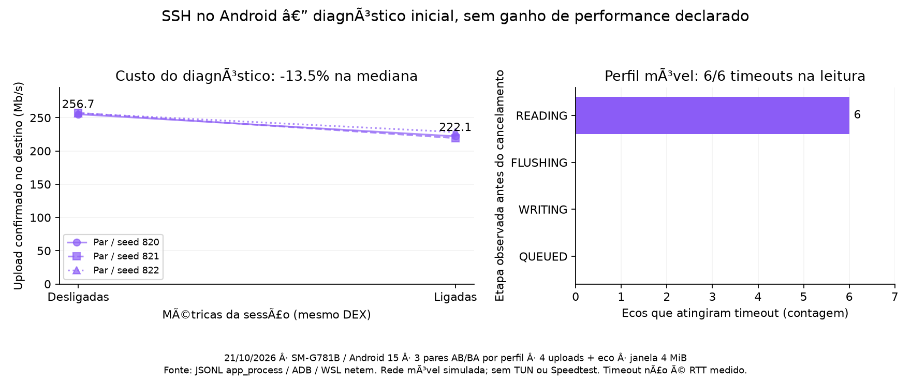

# Diagnóstico de fluxo SSH — primeira implementação, 21/10/2026

A instrumentação e a reprodução TDD estão implementadas no fork, na branch
`codex/ssh-flow-diagnostics`, como `2.28.7-vpn.3-SNAPSHOT` local. A janela de recepção
continua em **4 MiB**. Esta entrega identifica esperas; não contém uma otimização de
escalonamento nem demonstra ganho de jitter. O app continua usando `2.28.7-vpn.2`.

## Resultado que muda a investigação

Nos seis uploads do perfil móvel simulado, o eco de 32 bytes chegou à etapa READING
e atingiu o timeout de 12 s sem receber resposta. A escrita terminou e o flush local
levou **1,39–1,86 ms**. As stacks dos seis workers mostram espera no pipe de leitura,
não no monitor de envio. Isso não significa que os bytes já chegaram ao servidor:
flush local não confirma entrega remota.

Nos três casos com métricas ligadas, no instante do timeout:

- CREDIT_WAIT tinha **4 operações em andamento**: os uploads aguardavam crédito remoto.
- WRITE_LOCK_WAIT e TRANSPORT_WRITE tinham **0 operações em andamento**.
- CHANNEL_DELIVERY tinha **0 entregas**: nenhuma resposta ao eco foi entregue ao consumidor.
- REKEY_WAIT permaneceu zerado; não há indício de rekey nesses timeouts.
- O maior WRITE_LOCK_WAIT concluído ficou entre **12,02 e 18,34 ms**; o maior
  TRANSPORT_WRITE concluído, entre **1,43 e 2,49 ms**.

Isso não sustenta tratar esses timeouts como starvation do lock local de envio.
A prioridade passa a ser localizar o atraso no caminho ordenado compartilhado,
na fila de bytes já aceitos, no servidor SSH ou no destino. Não foi medido ainda
quando o pedido de eco chegou ao servidor, portanto a localização exata permanece
aberta. ADB reverse e o relay do laboratório também acrescentam buffers.

As somas de CREDIT_WAIT chegam a aproximadamente 52 s porque acumulam quatro
escritores concorrentes durante a conexão, incluindo aquecimento. Não representam
52 s de espera de um único eco. Contagens incluem os intervalos de polling.

## Implementação e TDD

`SessionFlowMetrics` guarda contagem, soma, máximo e operações em andamento para:
crédito remoto, rekey, monitor de envio, encode/MAC/criptografia, escrita/flush do
transporte e entrega ao consumidor. Guarda também bytes solicitados e fragmentações.
Usa contadores de tamanho fixo, sem payloads, destinos ou credenciais. Ativação é
explícita por sessão; `setFlowMetrics(null)` desliga a coleta. Snapshots são
não bloqueantes e eventualmente consistentes, sem garantia de visão atômica de todos
os contadores. Máximos e somas incluem somente intervalos encerrados.

O teste de disputa segura uma escrita no transporte e inicia outros três uploads,
um fluxo pequeno e um keep-alive. Reproduz os cinco escritores aguardando o caminho
compartilhado, libera o transporte e verifica os dados, crédito e conclusão de todos.
Demonstra bloqueio enquanto a escrita está retida; não demonstra falta de justiça
após o transporte voltar a drenar. Os dois testes iniciais falharam sem a ligação dos
contadores e passaram depois dela. Logs red/green acompanham os resultados.

Também foram validados cancelamento durante crédito/rekey, fragmentação com crédito
parcial, entrega normal/estendida bloqueada, erro preservado, contadores concorrentes,
snapshot imutável e desligamento da coleta mantendo os mesmos bytes enviados.

O probe registra etapas de cada eco, durações incompletas como `null`, snapshots
antes da medida/depois do aquecimento, no timeout e no encerramento da medida, além
de até 16 frames do worker em timeout. A API nova é acessada por reflexão para o
mesmo probe funcionar contra a release antiga. O resumo preserva a etapa do timeout
e não inventa RTT para operações incompletas. As observações de etapa, stack e
contadores são consecutivas, não um trace atômico.

## Custo observado

Primeira série: release publicada versus snapshot com coleta desligada, dois pares
AB/BA, upload e download sem limitação artificial, oito execuções:

- Upload confirmado: mediana **255,33 → 254,75 Mb/s** (−0,23%).
- Download: **315,00 → 315,19 Mb/s** (+0,06%).
- CPU/MiB: upload **32,56 → 32,76 ms**; download **20,12 → 20,31 ms**.
- RTT p95 por execução: upload, mediana **69,35 → 73,81 ms**; download,
  **257,05 → 277,27 ms**, com uma execução candidata em 296,59 ms.
- Nenhum timeout ou erro de carga. Dois pares são insuficientes para concluir
  ausência de regressão de latência ou equivalência estatística de vazão.

Segunda série: o **mesmo DEX candidato** com coleta desligada versus ligada, três
pares por perfil, doze execuções:

- Sem limitação: upload **256,70 → 222,08 Mb/s** (−13,49% na razão das medianas).
  Os três pares tiveram menor vazão com coleta ligada. CPU/MiB **32,50 → 37,55 ms**
  (+15,56%). A instrumentação completa tem custo relevante nesse cenário.
- Perfil móvel: upload **2,805 → 2,739 Mb/s** (−2,33%); faixas se sobrepõem.
  CPU/MiB **60,32 → 88,38 ms**. Houve **3/3 timeouts em cada modo**, sem RTT válido.
- RTT p95 sem limitação: **64,34 → 55,53 ms**, mas houve menos vazão com coleta
  ligada. Isso não demonstra melhoria de latência do transporte.
- Nenhum erro de carga nas duas séries. A coleta continua desligada por padrão;
  serve para localizar a espera e não deve ser ligada permanentemente no app.

## Condições e validação

SM-G781B, Android 15, app_process → ADB reverse → relay WSL → veth/netem → OpenSSH.
Quatro canais de carga e um de eco na mesma sessão, AES-256-CTR/HMAC-SHA2-512,
janela local de 4 MiB por canal e pipe limitado a 1 MiB. Aquecimento sob carga de
1,5 s, medida solicitada de 8 s, deadline por eco de 12 s, intervalo entre ecos de
20 ms e cooldown de 2 s. Um timeout pode estender a fase além dos 8 s solicitados.
Perfil móvel: 60 ± 25 ms por sentido, perda de 0,3%, 12/3 Mb/s e fila de 128 skbs.
Sementes 800–801 na primeira série e 820–822 na segunda. AB/BA alternado; mesma
semente não garante os mesmos segmentos perdidos entre variantes.

As etiquetas `vpn1`/`vpn2` são os lados A/B, não releases: na primeira série significam
release/snapshot; na segunda, snapshot desligado/ligado. O probe da segunda série
acrescenta snapshot inicial e stack de timeout. Cada comparação usa probe idêntico
nos dois lados; não juntar as duas séries como se fossem um único experimento.

- **508 testes unitários** na suíte completa passaram.
- **11 testes focados** passaram após a adição do caso de desligamento da coleta
  (há sobreposição com os 508; não somar como execuções únicas).
- **4 integrações SSH criptografadas** passaram com peer de janela de 32 KiB e consumo
  irregular: senha, chave pública, túneis concorrentes e destino rejeitado sem quebrar
  a sessão. O caso com senha também habilita e verifica os contadores.
- **8 testes Python** passaram no WSL, incluindo contadores concorrentes do laboratório.
- Formatação, imports e forbidden APIs passaram no JDK 25; DEX gerado com min API 25.
- Sem compilação no host durante as séries de rede. Laboratório privado, chaves,
  redirecionamentos ADB e pasta temporária do aparelho removidos após a coleta.

Os testes Android são da biblioteca com direct-tcpip, não do app com TUN/tun2socks,
nem de uma rádio celular real ou do jitter calculado pelo Speedtest. Não validam
por si só todos os transportes proxy/SSL, uma transferência longa com rekey ou
retomada da VPN após falhas. Nenhuma release nova foi publicada nesta etapa.

## Próximo experimento

1. Adicionar observação no destino privado para registrar quando o eco é recebido
   e respondido, distinguindo espera antes do servidor e espera da resposta.
2. Comparar um/quatro uploads e carga limitada/saturada, mantendo a janela local
   de 4 MiB. Controlar também os buffers acrescentados por ADB/relay.
3. Medir o acúmulo de dados aceitos pelo transporte antes de experimentar limite
   agregado de envio/backpressure. Um escalonador local não consegue reordenar
   bytes que já foram escritos no stream SSH.
4. Só então escolher uma mudança por vez, com TDD de integridade, controle,
   cancelamento, EOF e memória limitada; comparar sem métricas e repetir no app
   completo antes de promover uma release.

Dados brutos, resumos por execução, hashes e logs:
[benchmarks/ssh-flow-2026-10-21](benchmarks/ssh-flow-2026-10-21/metadata.json).
O gráfico é reproduzível com `tools/network/plot_flow_diagnostics.py` no fork.
