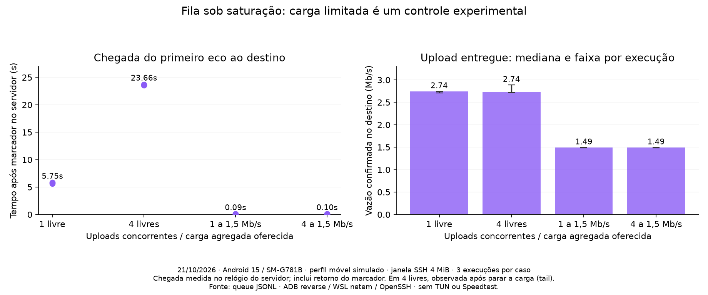
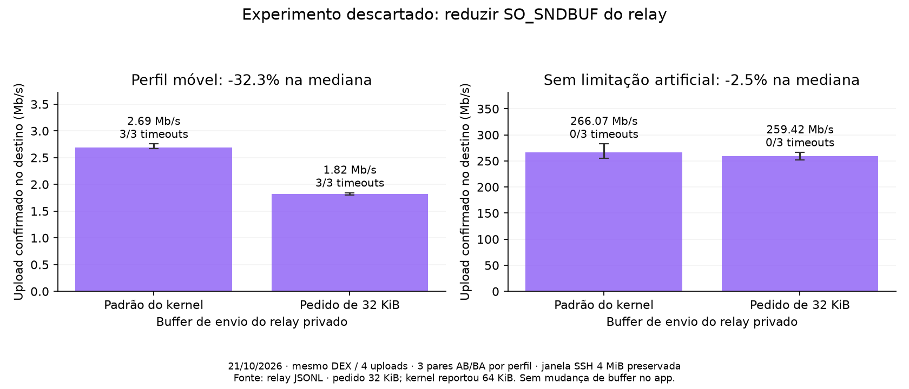

# Filas no túnel SSH: observação no destino e controles — 21/10/2026

O atraso foi reproduzido antes de o pedido completo chegar ao serviço de eco atrás
do OpenSSH. Com quatro uploads saturados, o destino só recebeu o primeiro eco
cerca de **23,66 s** após o marcador inicial, na mediana das três execuções com
observação após o timeout. Depois de recebido, o serviço aceitou a resposta para
envio em **0,57–1,32 ms**, incluindo o custo do journal. O problema também foi
reproduzido no caminho por Wi-Fi. Isso localiza a espera antes do destino, mas
não separa ainda fila no cliente/relay, retransmissão TCP e encaminhamento no OpenSSH.

Foram realizadas **30 execuções controladas**, mais dois smoke tests, no SM-G781B
com Android 15. Todas usam o JAR publicado `2.28.7-vpn.2`, sem métricas completas,
janela local de **4 MiB** e pipe de 1 MiB. Não houve alteração do algoritmo de envio,
de keep-alive, da janela, do app ou de sua dependência Gradle nesta etapa.

## O que foi implementado e testado

O laboratório privado agora mantém um journal de tamanho limitado com a sequência
e os timestamps do último pedido completo de 32 bytes recebido e da última resposta
aceita para envio. Atualização por substituição atômica, sem conteúdo de configuração,
credenciais ou payloads. Recebimento e envio são eventos distintos: falha em sendall
não registra resposta enviada. Um pedido novo também não herda o envio do anterior.
O eco é validado byte a byte no Android; o observador apenas o enquadra em 32 bytes.

O probe obtém um marcador do relógio WSL antes de submeter o eco e consulta o journal
após conclusão/timeout. Diferenças de chegada e serviço usam apenas o relógio WSL;
não se subtraem relógios Android/Windows/WSL. O intervalo de chegada inclui o retorno
do marcador e a submissão local, portanto não deve ser chamado de latência unidirecional.
Os snapshots de etapa, journal e stack são observações consecutivas, não um trace atômico.

Após o timeout, a medida de vazão/CPU é encerrada, a carga oferecida é parada e o
journal é observado por até 15 s adicionais. A observação tardia não entra na vazão
nem no RTT. Escritores que já estavam numa chamada podem completar aquele bloco.
Esse procedimento altera a carga depois do deadline; não mede a chegada sob
saturação mantida indefinidamente. Uma resposta aceita por sendall ainda não é
confirmação de que o Android a recebeu.

Há controle de carga agregada compartilhado pelos escritores, usado apenas no
benchmark, além de scripts reproduzíveis para canais/carga, buffer do relay e rota.
Foram validados orçamento agregado concorrente, modo ilimitado, descarte de crédito
após ociosidade e origem negativa do relógio. O journal e o classificador foram
escritos com testes antes da implementação; logs red/green acompanham os resultados.
Os logs red iniciais registram a ausência dos módulos, antes da implementação.

## Um ou quatro uploads; carga saturada ou limitada

Três execuções por condição, sementes 860–862, ordem direta/invertida/direta. Perfil
móvel simulado: 60 ± 25 ms por sentido, perda de 0,3%, download/upload de 12/3 Mb/s,
fila de 128 skbs. Quatro túneis compartilham uma única sessão SSH quando selecionados.

- **Um upload livre:** 2,741 Mb/s de mediana; primeiro eco recebido no destino em
  5,75 s de mediana. Houve somente dois RTTs completos por execução, sem timeout.
  O p95 descritivo por execução tem mediana de 5.848 ms e pouca amostragem.
- **Quatro livres:** 2,735 Mb/s; nenhum RTT completo; 3/3 timeouts na etapa READING.
  O pedido completo estava ausente no destino nas três consultas de timeout. Após
  parar a carga, chegou entre 23,55 e 23,72 s após o marcador inicial.
- **Um limitado a 1,5 Mb/s:** 1,490 Mb/s entregues; 36–39 ecos por execução, sem
  timeout; mediana dos p95 por execução de 270 ms.
- **Quatro limitados a 1,5 Mb/s no total:** 1,491 Mb/s; 36–39 ecos por execução,
  sem timeout; mediana dos p95 de 281 ms.

A carga limitada demonstra a relação com saturação. Não é uma melhoria de velocidade
nem um limite a ser aplicado à VPN: ela reduz deliberadamente a quantidade de dados
oferecida à rede.

## Experimento descartado: reduzir o buffer do relay

Mesmo DEX nos dois lados, quatro uploads sem limitador, três pares AB/BA/AB por
perfil, sementes 900–902. A única intervenção foi solicitar SO_SNDBUF de 32 KiB no
socket do relay WSL em direção ao OpenSSH. O kernel reportou 64 KiB nesse socket;
o buffer padrão permaneceu sob escolha do kernel. Os valores reais no momento da
conexão estão no journal, e podem variar entre execuções. Não se alterou o socket
Android nem qualquer buffer de recepção SSH.

No perfil móvel, a mediana caiu de **2,693 para 1,823 Mb/s (−32,3%)** e houve 3/3
timeouts em cada braço. Com 32 KiB solicitados, o pedido continuou ausente no destino
até o fim da observação adicional, aproximadamente 27 s após o início do eco.
Isso não é um RTT de 27 s: a chegada não foi observada nesse intervalo.
CPU/MiB foi de 61,24 para 69,19 ms. Sem limitação artificial, a mediana foi de
266,07 para 259,42 Mb/s (−2,5%), com faixas sobrepostas e nenhum timeout; CPU/MiB
foi de 30,77 para 33,16 ms.

O pedido de buffer de 32 KiB foi **descartado** como ajuste: não resolveu o timeout
e prejudicou a vazão móvel nesse laboratório. Não há evidência aqui para diminuir
indiscriminadamente buffers ou a janela de 4 MiB.

## Controle de caminho: USB/ADB e Wi-Fi

Três pares AB/BA/AB, sementes 940–942, mesmo DEX e biblioteca, relay em configuração
padrão, quatro uploads livres e perfil móvel simulado. No braço Wi-Fi, os sockets de
dados e controle conectam pelo wlan0 a uma ponte Windows temporária permitida apenas
para o IP do aparelho; depois seguem para o relay WSL. O ADB apenas inicia o processo.
A rota do UID 2000 foi conferida e o smoke test por Wi-Fi completou 35 ecos válidos.

**3/3 timeouts em cada caminho**, sempre esperando leitura e sem pedido completo no
destino no instante consultado. Depois de parar a carga, os três pedidos via ADB
chegaram entre 23,49 e 24,56 s após o marcador. Via Wi-Fi, dois chegaram em 23,31 e
26,27 s; o terceiro não chegou até o limite de observação adicional.

A vazão mediana foi 2,672 Mb/s via ADB e 2,208 Mb/s via Wi-Fi, com variação ampla
no Wi-Fi (1,562–2,712 Mb/s). Esse braço inclui Wi-Fi e uma ponte Windows adicional:
não é um teste que isola somente o custo do USB, nem uma comparação de desempenho
do app em produção. Mostra que o fenômeno não requer o ADB reverse.

## Validação, preservação e limites

**19 testes Python passaram no WSL**, incluindo os testes de observação e de buffer.
O harness Java do pacer passou antes das três compilações de DEX; bytecode Java 8,
DEX min API 25. Os 30 registros têm janela de 4 MiB, métricas completas desligadas
e **zero erros de carga**. O smoke inicial por ADB completou 55 ecos; o de Wi-Fi, 35.
A suíte anterior da biblioteca permanece documentada no
[relatório de instrumentação](ssh-flow-diagnostics-2026-10-21.md).

Não foram feitas compilações no host durante a coleta de cada série. Foram removidos
os dois ADB reverse, a pasta temporária do aparelho e a chave de laboratório; a ponte
Windows e o namespace WSL foram encerrados. Não se usaram credenciais de clientes.

Os dados são de direct-tcpip, não do caminho completo TUN/tun2socks/SOCKS, de uma
rádio móvel real ou do Speedtest. Os caminhos ADB e Wi-Fi ainda compartilham o
relay WSL e o OpenSSH. Três repetições não demonstram equivalência estatística nem
cobrem todo tipo de rede. O teste é de upload; não se generaliza para download.
Máximo, soma e p95 têm definições diferentes e não devem ser chamados de jitter Ookla.

## Próxima intervenção orientada pela evidência

O próximo passo é correlacionar a posição do pacote de eco no stream cifrado com
os bytes aceitos pelo relay e o estado da fila TCP nesse mesmo instante. Assim será
possível distinguir espera antes do relay, bytes pendentes no transporte e espera
no encaminhamento do OpenSSH. O teste precisa considerar bytes parcialmente aceitos
numa escrita ainda bloqueada e preservar sequência, cancelamento e EOF.

Depois, experimentar controle do acúmulo de bytes ainda pendentes de envio,
separadamente do espaço necessário para dados em trânsito e da janela de recepção
SSH. Cada alteração terá comparação de vazão e latência e validação no app completo.
Um escalonador de canais não pode reordenar bytes já escritos no stream compartilhado;
a investigação atual não justifica escolhê-lo como solução para estes timeouts.

Os ajustes de 1,5 Mb/s e SO_SNDBUF de 32 KiB ficam restritos ao laboratório. O app
continua em `2.28.7-vpn.2`; não foi promovida uma release nova nesta etapa.

[Dados brutos, hashes, fontes exatas das séries e logs](benchmarks/ssh-queues-2026-10-21/metadata.json).
