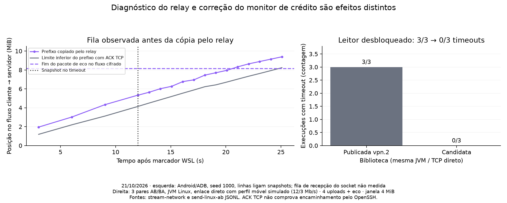
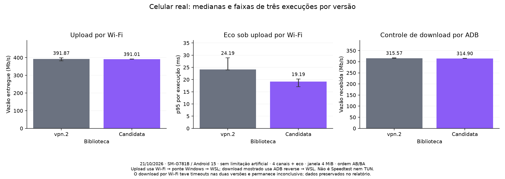

# Isolamento do envio SSH: leitor liberado sem reduzir a janela

Em 21/10/2026 foi reproduzido e corrigido um bloqueio do leitor unico da sessao.
Uma escrita de upload segurava o monitor do canal enquanto esperava o socket;
ao receber WINDOW_ADJUST para esse canal, o leitor parava em
`Channel.addRemoteWindowSize`, impedindo a entrega do eco de outro canal.
O destino ja havia recebido e respondido ao pedido. No controle direto Linux,
a publicada vpn.2 teve timeout em **3/3 execucoes**, a candidata em **0/3**.
A janela permanece **4 MiB**, sem diminuir buffers para esconder saturacao.

Esta e uma candidata `2.28.7-vpn.3-SNAPSHOT` sobre b6dc2df, comparada com a
publicada `2.28.7-vpn.2` (1212caa). O commit desta rodada inclui tambem os
instrumentos que permitiram distinguir filas de transporte do bloqueio do leitor.
Evidencias, hashes e scripts historicos estao em
[benchmarks/ssh-send-isolation-2026-10-21](benchmarks/ssh-send-isolation-2026-10-21/metadata.json).

## Correcao e TDD

`Channel.sendLock` serializa DATA, EOF, CLOSE e WINDOW_ADJUST de saida.
O monitor do canal continua protegendo o credito remoto, mas nao fica retido
pela escrita bloqueante no OutputStream publico ou nos pumps direct/forwarded.
A serializacao global da criptografia da Session permanece intacta.
Nao foram alterados algoritmos criptograficos, janela, pipe, agendamento ou polling.

O teste novo usa Session.write real com um destino de transporte controlado.
Na revisao anterior, as duas variantes (OutputStream publico e pump) falharam:
o recebimento de credito e a entrega ao outro canal ficaram bloqueados.
Com o fix, passam, conferindo payload, credito final e janela de 4 MiB.
Outros casos verificam ordem DATA/EOF/CLOSE e desconexao enquanto falta credito.
O log red arquivado corresponde ao teste corrigido executado contra os quatro
arquivos de producao anteriores; erros anteriores de montagem da fixture nao
sao usados como evidencia da regressao.

Validacao encerrada:

- **514 testes unitarios** da biblioteca, zero falhas/erros/skips, com formatacao,
  imports e verificacao de APIs proibidas (`mvnw -B -Pformat verify`).
- **5 integracoes criptografadas** da fixture loopback na rodada final. Incluem
  quatro canais com prefixos de 32 KiB enviados, keep-alive, rekey, retomada e
  verificacao integral de 256 KiB por canal, EOF, novo keep-alive e novo eco.
  Essa rodada executou tambem os cinco casos unitarios de isolamento; nao soma
  esses testes repetidos aos 514. O keep-alive exercitado aqui parte do cliente.
- **29 testes Python** no Linux, incluindo contadores, classificacao e consultas
  de fila em TCP real. Harness Java verifica limites do fluxo, escrita bloqueada
  e incerteza apos erro parcial. Smoke Android: **46 ecos** com offsets.
- App Android: **373 testes, 4 ignorados, zero falhas/erros** (369 aprovados),
  build debug com override local do JAR, verificacao de `Channel.sendLock` no
  DEX, instalacao e abertura no SM-G781B/Android 15.

O APK instalado foi construido a partir da arvore local atual do app, que inclui
outras alteracoes de desenvolvimento. A dependencia padrao do app continua vpn.2;
esta rodada nao publicou release estavel nem promoveu a candidata no build padrao.
O hash do JAR medido e do APK instalado consta em metadata.json. O JAR candidato
foi preservado antes da ultima adicao de teste de rekey; o codigo de producao e igual.

## Primeiro diagnostico: onde o eco ficou no caminho com relay

Foram correlacionados o intervalo do pacote de eco no fluxo cifrado cliente-servidor,
o prefixo copiado pelo relay, os limites aceitos pelo socket de saida e as filas TCP.
Contam-se inclusive identificacao/autenticacao SSH; nao se gravam payloads ou chaves.
Os snapshots nao seguram o lock durante send/recv e preservam limites de escritas
em andamento. Consultas de OUTQ e OUTQNSD sao sequenciais, nao um snapshot atomico.
No Linux, OUTQ usa write_seq-snd_una e OUTQNSD write_seq-snd_nxt; portanto OUTQ
inclui dados ainda sem ACK, enquanto OUTQNSD conta somente dados ainda nao enviados.
[Fonte: implementacao TCP do kernel Linux](https://raw.githubusercontent.com/torvalds/linux/v6.18/net/ipv4/tcp.c).

Na serie Android/ADB, quatro uploads, perfil movel, seed 1000, no timeout de 12 s:
fim do pacote de eco = **8.547.243 bytes**, prefixo copiado pelo relay =
**5.589.835 bytes**, aceitos no cliente = **12.738.475 bytes**.
O relay ainda nao havia copiado o pacote de eco para userspace. A margem para
um recv em andamento e de ate 65.536 bytes e nao muda essa classificacao.
A fila de recepcao do socket do relay **nao foi medida**: BEFORE_RELAY_COPY
inclui essa fila e as etapas anteriores, sem atribuir a espera apenas ao Android.

As seis fases moveis de quatro uploads (tres ADB e tres Wi-Fi) tiveram timeout
nessa classe. Um upload nao teve timeout. Essa evidencia localiza uma fila no
caminho com proxy TCP, mas sozinha nao demonstra o defeito do monitor.

O controle seguinte usou a **mesma JVM Linux** para acessar o namespace por
proxy TCP e diretamente pelo veth. As duas rotas tiveram 3/3 timeouts. Na direta,
o destino recebeu e respondeu ao eco em aproximadamente 1,97–2,45 s, mas o cliente
nao o entregou ate o deadline. Isso levou ao teste de regressao e ao fix acima.

## Comparacao da biblioteca e controles no celular

O controle direto Linux comparou vpn.2 e candidata, tres pares alternados AB/BA,
seeds 1100–1102, quatro uploads e eco na mesma sessao. Em **todos os tres**
timeouts da referencia, o dump mostra o leitor BLOCKED em addRemoteWindowSize.
Na candidata nao houve timeout. Vazao mediana: **2,696 → 2,682 Mb/s**;
a diferenca de aproximadamente -0,5% nao indica ganho de vazao.
Ainda existe fila TCP: o p95 por execucao da candidata ficou em 2,87–4,00 s,
com somente dois ou tres ecos completos por fase. A referencia nao completou
ecos; nao existe p95 de referencia para calcular uma melhora percentual de RTT.
CPU da JVM nao foi medida nessa serie.

No celular real, sem limitacao artificial, com o mesmo probe e tres pares por caso:

- **Upload Wi-Fi:** vazao mediana **391,87 → 391,01 Mb/s**; mediana dos p95 do
  eco **24,19 → 19,19 ms**, queda observada de 20,7%. Faixas de p95 por execucao:
  23,95–28,87 ms e 17,04–20,20 ms. CPU/MiB: 24,10 → 23,75 ms.
  Nenhum timeout/erro de carga. Sao tres pares, sem garantia estatistica para
  outros aparelhos ou redes.
- **Download Wi-Fi, inconclusivo:** as duas versoes tiveram **3/3 timeouts**,
  com leitor esperando SocketInputStream.read, sem o bloqueio de credito acima.
  Medianas de vazao 1,95 e 55,13 Mb/s, ambas anomalas para esse enlace.
  A grande diferenca nao e anunciada como ganho do fix. A causa desse comportamento
  do caminho Wi-Fi/ponte/WSL nao foi isolada; todos os dados foram preservados.
- **Controle de download por ADB:** **315,57 → 314,90 Mb/s**, nenhum timeout/erro.
  Mediana dos p95 251,54 → 252,79 ms; CPU/MiB 20,315 → 20,322 ms.
  As faixas se sobrepoem e esse caso nao demonstra ganho de download/latencia.

O observador de offsets teve uma serie separada, mesma biblioteca nos dois lados,
tres pares de upload sem limitacao: vazao 256,16 → 256,94 Mb/s e CPU/MiB
32,95 → 33,57 ms (~+1,9%). Isso nao comprova overhead zero. A instrumentacao
completa SessionFlowMetrics ficou **desligada em todas as series desta rodada**;
offsets ficaram desligados nos A/Bs finais da biblioteca.

## Metodo, reproducao e limites

Ha **45 fases** de rede arquivadas: 15 de offsets/overhead, seis do controle de
rotas na mesma JVM e 24 dos quatro A/Bs da biblioteca (Linux, Wi-Fi upload,
Wi-Fi download e ADB download). Sao 33 fases Android e 12 JVM, alem do smoke.
Cada resumo preserva quantidade de ecos, timeouts, erros, medianas e faixas por
execucao. Nao foram agrupadas amostras de series diferentes em um unico percentil.

Perfil movel: netem 60 +/- 25 ms por sentido, perda 0,3%, 12/3 Mb/s, fila de
128 skbs. Sementes pareadas nao garantem perda dos mesmos segmentos. Solicitados
8 s de carga, aquecimento 1,5 s, deadline absoluto de eco 12 s, intervalo de
2 s entre fases. Um eco em andamento pode estender a medida; `seconds` e os
contadores brutos registram a duracao real. O tail apos parar a carga nao integra
vazao/CPU e altera a condicao de carga. Cifra AES-256-CTR, HMAC-SHA2-512,
janela 4 MiB, pipe 1 MiB. Sao canais direct-tcpip crus, sem TUN/tun2socks ou
adaptador do app. Wi-Fi inclui ponte Windows e WSL; ADB inclui reverse e relay.
O controle direto JVM acessa 10.205.33.2:22022, sem terminar TCP no relay.

Veja [tools/network/README.md](../../tools/network/README.md) para os comandos.
`plot_send_isolation.py STREAM LINUX_AB ANDROID_UPLOAD ADB_DOWNLOAD OUTDIR`
reproduz as figuras; queue_summary.py e stream_classify.py reproduzem os resumos.
O metadata registra os hashes dos binarios medidos e fontes disponiveis.
O primeiro probe Android tem snapshot exato separado; o controle JVM intermediario
tem hash do JAR registrado, e os A/Bs finais compartilham o mesmo probe final.
Nao se deve recompilar o probe final e chama-lo de binario historico intermediario.

O ambiente privado foi desmontado, as chaves temporarias e redirecionamentos ADB
removidos. O APK de desenvolvimento permanece instalado. Este ensaio **nao mede
Speedtest completo, VPN/TUN ou radio celular real** e nao demonstra eliminacao
geral de jitter. O proximo passo e validar a candidata no caminho completo do app,
com pares de Speedtest na mesma rede/servidor, e isolar o download Wi-Fi anomalo
antes de promover uma nova release estavel.
