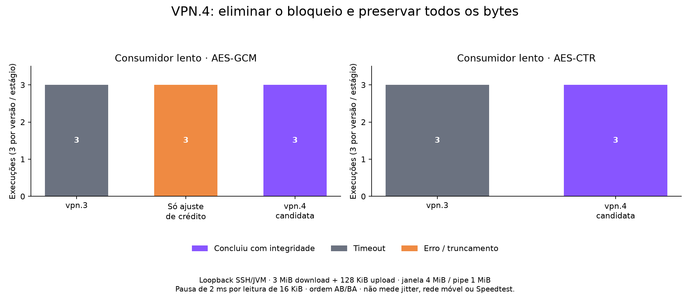

# VPN.4: credito bidirecional e integridade com consumidor lento

Desenvolvimento sobre a release **2.28.7-vpn.3**, commit 3ea9b49, na branch
`codex/ssh-vpn4-control-credit`. Esta rodada implementa duas correcoes internas,
sem alterar a janela de **4 MiB**, o limite do pipe de **1 MiB**, os algoritmos
padrao ou a API publica. A versao e **2.28.7-vpn.4-SNAPSHOT**; a dependencia
padrao do app continua na vpn.3 publicada.

## 1. Reposicao de credito nao pode esperar pelo credito oposto

O escritor de upload mantinha `channel.sendLock` enquanto esperava credito do
servidor. Ao baixar mais de metade da janela, o leitor tentava adquirir esse
mesmo lock para enviar WINDOW_ADJUST. O leitor ficava impedido de processar
o credito remoto que liberaria o upload, assim como os dados de outros canais.

O teste dirige o **Session.run real**, com pacotes recebidos em ordem: dados
que exigem reposicao da janela, credito remoto e dados de outro canal. Na base
vpn.3, as duas variantes (dados normais/estendidos) falham por falta de progresso.
Na candidata, ambas terminam com payload, credito e janela conferidos.

A reposicao passa diretamente pela serializacao do transporte, sem adquirir
sendLock. Dentro desse lock da sessao, antes da codificacao, verifica-se se o
canal esta fechando. Assim, um ajuste ja iniciado precede CLOSE no fluxo; um
ajuste pendente e suprimido se o fechamento ja foi marcado. Dois testes de
corrida verificam essas duas ordens e os contadores de operacoes pendentes.
A serializacao de DATA/EOF/CLOSE entre escritores permanece inalterada.

O controle de fluxo conta dados enviados por sentido; o encerramento tem sua
propria sequencia de mensagens. A implementacao preserva essa separacao e a
ordem no transporte. [Referencia: RFC 4254, secoes 5.2 e 5.3](https://www.rfc-editor.org/rfc/rfc4254.html#section-5.2).

## 2. Crescimento de um pipe cheio com indices deslocados perdia dados

A primeira correcao isolada revelou um segundo defeito: com consumidor lento,
o recebimento chegava ao EOF sem entregar todos os bytes, embora a sessao tivesse
escrito **3.145.760 bytes** no pipe (3 MiB de dados + digest de 32 bytes).
O teste criptografado falhou de forma intermitente; a pausa controlada de 2 ms
por bloco reproduziu o truncamento em **3/3 execucoes** dessa candidata parcial.
Essas falhas foram preservadas, sem serem descartadas como ruido.

O defeito estava no crescimento do buffer circular quando `in == out` (cheio)
e `out != 0`. A copia antiga mantinha out e colocava in no fim do buffer antigo,
perdendo o trecho ainda nao lido anterior a out. O caso deterministico enche
32 KiB, consome 16 KiB, escreve 16 KiB para completar a volta e adiciona mais
16 KiB para provocar crescimento. Deveriam restar **49.152 bytes**, mas restavam
**32.768**: perda de **16.384 bytes**, nos fluxos normal e estendido.

A correcao lineariza os dois segmentos do anel em ordem antes de crescer,
restaurando out=0 e in=tamanho antigo. O total de bytes copiados e o mesmo tamanho
do buffer antigo; nao ha nova fila, thread ou aumento do limite de memoria.
O teste foi ampliado para deslocamentos 0, 1, 16.384 e 32.767 bytes, nos dois
fluxos. Outro caso verifica EOF seguido de CLOSE com leitura pausada e pipes de
32 KiB e 1 MiB. Os testes verificam todos os bytes e EOF.

## Comparacao criptografada e limites das medidas

O servidor local envia **3 MiB** antes de consumir **128 KiB** de upload, cujo
credito inicial e 32 KiB. Depois de enviar, espera a reposicao da janela do
cliente antes de consumir o upload. O cliente le concorrentemente. Esta e uma
dependencia de credito deliberada para reproduzir o bloqueio, nao uma estimativa
da frequencia com que ele ocorre em servidores reais.

O primeiro estagio, somente com a correcao do credito, concluiu os seis casos de
consumidor rapido (tres AES-CTR e tres AES-GCM); vpn.3 teve seis timeouts.
Ao pausar a leitura, o primeiro estagio teve tres truncamentos. A candidata
final inclui tambem a correcao do pipe. Os dados de todos os estagios, hashes dos
JARs e ordem dos pares ficam preservados em
[benchmarks/ssh-vpn4-duplex-2026-10-21](benchmarks/ssh-vpn4-duplex-2026-10-21/metadata.json).

Nos A/Bs finais com leitor lento, **vpn.3 teve 3/3 timeouts e a candidata final
concluiu 3/3 sem erro**, tanto em AES-GCM quanto em AES-CTR. Sao seis conclusoes
verificadas contra seis timeouts. Os tempos medianos da candidata foram 594,5 ms
e 597,4 ms, respectivamente; incluem as pausas artificiais do consumidor e nao
representam RTT ou vazao maxima. No estagio parcial os tres erros eram EOF antes
dos 3 MiB, sem timeout, e nao devem ser confundidos com uma melhoria valida.

Ha **30 fases de loopback** preservadas: 12 de leitor rapido no estagio parcial,
seis de leitor lento que revelaram o truncamento e 12 de leitor lento na candidata final.
Os probes historicos evoluiram entre series; os hashes constam em cada metadata.
O fonte atual reproduz os ensaios finais. Nao se misturam os tempos entre series.

Cada A/B usa tres pares alternados AB/BA, a mesma fixture e o mesmo probe nos
dois lados, JDK 25, deadline de 5 s, janela 4 MiB e pipe 1 MiB. O recebimento
confere 3 MiB completos e EOF; o servidor devolve SHA-256 do upload para verificar
tambem o outro sentido. A leitura lenta pausa 2 ms a cada 16 KiB. AES-CTR usa
HMAC-SHA2-512; AES-GCM usa autenticacao AEAD. Os A/Bs finais de leitor lento
mantem as metricas opcionais ligadas nos dois lados, para exercitar esse caminho.
Isso nao mede o custo do observador, pois nao ha comparacao ligado/desligado.

Tempos de conclusao sao registrados somente para fases que concluiram.
Timeouts sao censurados e nao servem de base para calcular uma melhora percentual
de latencia. Nao ha limitacao netem, TUN, Android ou radio celular nesse ensaio.
Nao foram feitas compilacoes durante as fases de comparacao.

## Controle adicional com perfil movel simulado

Foram coletados **seis pares, 12 fases**, com os mesmos JARs finais, probe
anterior de rede, JVM Linux/OpenJDK 21 e acesso TCP direto ao namespace privado,
sem terminar TCP em um relay. O perfil aplica 60 +/- 25 ms por sentido, perda
0,3%, banda 12/3 Mb/s e fila de 128 skbs. Quatro uploads compartilham a sessao
com eco; janela 4 MiB, pipe 1 MiB, AES-256-CTR/HMAC-SHA2-512, metricas desligadas.
CPU nao foi medida. Sao solicitados 8 s, com aquecimento de 1,5 s, deadline do
eco de 12 s e intervalo de 2 s entre fases; seconds registra a duracao real.

A primeira rodada (seeds 1100–1102) teve vazao mediana 2,748 → 2,630 Mb/s,
uma diferenca de -4,3%. Por esse sinal, a coleta foi ampliada com novas sementes
1140–1142, sem descartar as anteriores. Na confirmacao: 2,749 → 2,729 Mb/s (-0,74%).
Nos **seis pares combinados**, a mediana foi **2,749 → 2,718 Mb/s (-1,1%)**;
faixas 2,667–2,758 e 2,417–2,776 Mb/s. A mediana das variacoes pareadas por semente
foi -1,14%. Esse resultado nao demonstra ganho de vazao nem equivalencia geral.

Nenhuma das 12 fases teve timeout ou erro de carga. A mediana dos p95 por
execucao foi 3,888 → 3,624 s, com somente dois a quatro ecos completos por fase.
Nao se usa essa amostra pequena para anunciar ganho geral de latencia/jitter.
As filas sob saturacao continuam presentes. Sementes iguais nao garantem perda
dos mesmos segmentos; a ordem foi alternada AB/BA em cada rodada.
Os dois JSONLs originais, resumos separados, resumo combinado e variacoes
pareadas estao preservados. Sao **42 fases distintas** nesta rodada incluindo
o loopback. O ambiente privado e suas chaves foram removidos ao terminar.

## Reproducao e trabalho seguinte

Validacao final: **528 unitarios e 6 integracoes SSH aprovados**, zero
falhas/erros/skips, com formatacao/imports/APIs proibidas (`clean verify`, perfil
format e fixture duplex). Os 29 testes Python do laboratorio passaram no WSL.
Os 33 casos unitarios focados tambem passaram antes da suite completa; sao
reexecucoes e nao se somam aos 528. A fixture foi encerrada e a credencial
temporaria apagada em cada rodada. Nenhum APK foi instalado nesta etapa.

O app compilou com override local do JAR final e teve **373 testes, 4 ignorados,
zero falhas/erros** (369 aprovados). O APK debug inclui a nova sobrecarga interna
`Session.write(Packet,Channel)`, conferida na tabela de metodos do DEX. Os hashes
do APK e do JAR constam no metadata. O build inclui a arvore local de desenvolvimento
do app e nao constitui um A/B limpo da VPN. A dependencia padrao permanece vpn.3.

Consulte [o laboratorio](../../tools/network/README.md#ciclo-bidirecional-de-credito-desenvolvimento-vpn4).
`compare_duplex_window.py` compila o probe uma vez, inicia uma fixture privada
em 127.0.0.1 e executa os dois JARs com o mesmo bytecode do probe. Credenciais
aleatorias sao passadas pelo ambiente e o arquivo de prontidao e apagado no fim.
`--cipher aes128-gcm@openssh.com --metrics --read-delay-ms 2` reproduz o caso lento
com AEAD; o padrao de cifra do probe e aes256-ctr. Use uma pasta de saida nova.
`plot_duplex_window.py CONTROL_ONLY_SLOW FINAL_GCM_SLOW FINAL_CTR_SLOW OUTPUT`
reproduz o grafico de resultados, que separa conclusao, timeout e truncamento.

O novo caso JUnit usa `loopback_ssh.py --duplex-window` e
`VTUNNEL_SSH_TEST_DUPLEX=true`, alem das variaveis de porta e senha da fixture.
Os testes anteriores de senha/chave, canais concorrentes, EOF, keep-alive e rekey
continuam na matriz. Os logs de validacao final constam no diretorio de evidencias.

Ainda precisam de medicao o desempenho no Android, radio movel real e a VPN
completa. Um consumidor cujo pipe alcance seu limite ainda pode bloquear o leitor
compartilhado; esta rodada corrige a perda no crescimento, nao implementa entrega
assincrona por canal. O envio de controle tambem pode esperar um socket/lock de
transporte bloqueado. Nenhuma destas correcoes elimina as filas TCP sob saturacao.
Uma nova release e a promocao da dependencia do app sao etapas posteriores.
