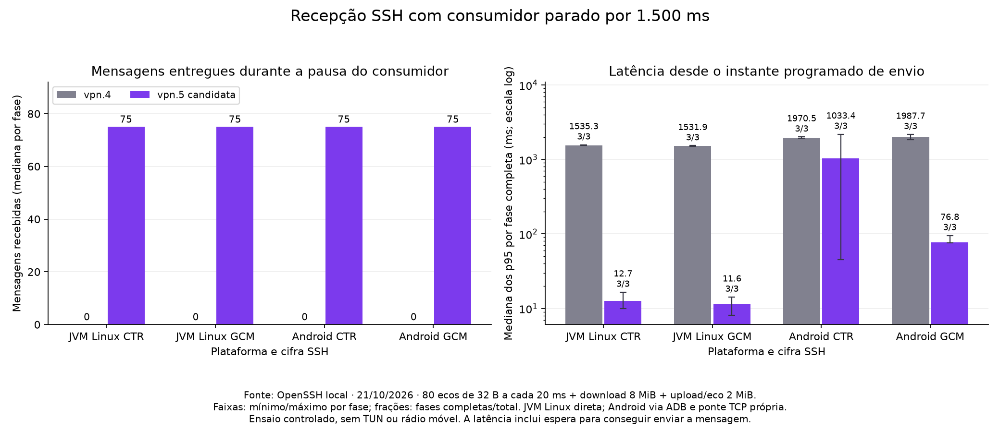
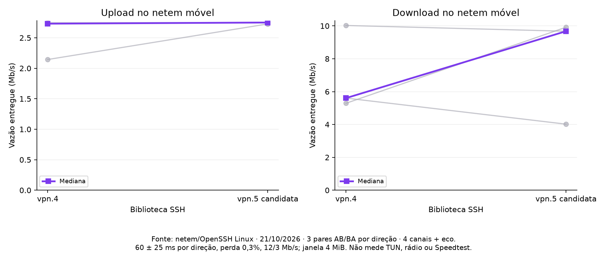

# vpn.5: isolamento da recepcao por canal

Implementacao de desenvolvimento `2.28.7-vpn.5-SNAPSHOT`, na branch
`codex/ssh-vpn5-receive-isolation`. A dependencia publicada do aplicativo continua
em vpn.4; a candidata e usada nos testes pelo override `vtunnelSshJar`.

## Problema e mudanca

O leitor unico da sessao escrevia sincronicamente em um pipe limitado a 1 MiB,
enquanto o aplicativo anunciava uma janela de 4 MiB. Um consumidor parado podia
reter esse leitor e impedir o processamento de dados e credito de outros canais.
Repor a janela ao entregar ao pipe, em vez de ao consumir, tambem permitia renovar
credito sem liberar armazenamento.

O caminho `getInputStream()`/`getExtInputStream()` agora usa armazenamento
segmentado proprio. O leitor copia os bytes uma vez para segmentos de 32 KiB,
sem aguardar espaco do consumidor. Nao ha executor, fila de tarefas ou thread
adicional por canal. Uma janela esgotada deixa de receber credito; outros canais
continuam sendo processados. Um segmento vazio pode ser reutilizado para evitar
realocacao em cada leitura de um fluxo rapido.

Dados normais e estendidos compartilham a mesma janela. O credito e contabilizado
antes da entrega, e sua reposicao acompanha bytes efetivamente consumidos,
agrupados em lotes de ate 256 KiB de limiar (ou um quarto da janela menor).
O tamanho anunciado permanece 4 MiB quando configurado pelo aplicativo.

A leitura libera o monitor do armazenamento antes de escrever WINDOW_ADJUST.
Assim, esperar transporte ou rekey no consumidor nao retira do leitor SSH o acesso
ao buffer. A escrita continua serializada pelo transporte cifrado existente;
WINDOW_ADJUST utiliza a ordenacao com CLOSE introduzida em vpn.4.

EOF e CLOSE acordam leitores e preservam bytes ja recebidos ate a drenagem.
Fechar o InputStream descarta seu armazenamento e acorda uma leitura bloqueada.
O dono do canal continua responsavel por chamar `channel.disconnect()` no finally.
Segmentos com bytes ainda nao drenados continuam contabilizados depois de CLOSE;
sao devolvidos quando esses bytes sao lidos ou o stream e fechado. Descontar
armazenamento ainda vivo permitiria ultrapassar o limite com streams antigos.

## Limites e contrato

`channel_receive_isolation=no` seleciona o pipe legado. O padrao e o caminho novo.
`max_input_buffer_size` controla somente o caminho legado: 1 MiB nao pode ser
um limite estrito do armazenamento novo se o peer recebeu credito para 4 MiB.

`channel_receive_memory_limit` configura o limite de armazenamento de recepcao
por sessao, em bytes; o padrao e 64 MiB, com minimo de um segmento de 32 KiB.
A politica padrao `channel_receive_budget_policy=allocated` contabiliza segmentos
realmente alocados, inclusive o segmento vazio reutilizavel. Canais ociosos nao
reservam uma janela inteira. O teste de 128 canais pequenos usa aproximadamente
4 MiB de armazenamento, preservando uma janela anunciada de 4 MiB por canal.

A admissao de todos os segmentos necessarios a um pacote ocorre antes de copiar
seus bytes. Se o orcamento se esgotar, o canal afetado falha explicitamente: seus
buffers sao liberados, leituras recebem IOException e o receive loop encerra
esse canal. O erro nao e apresentado como EOF normal de uma transferencia completa.
Outros canais continuam utilizaveis. Nao ha espera por espaco no consumidor.

Essa politica permite anunciar mais credito agregado do que o orcamento fisico.
Nao promete aceitar sem interrupcao todas as janelas de 128 consumidores parados
simultaneamente: 128 janelas de 4 MiB demandariam ao menos 512 MiB de dados.
Sob essa pressao, ha encerramento de canais por falta de recursos. Essa e uma
escolha explicita para preservar a concorrencia usual e o limite de armazenamento;
nao e perda silenciosa nem reducao oculta da janela SSH.

A politica opcional `channel_receive_budget_policy=reserve` reserva, antes de
CHANNEL_OPEN, a janela completa mais 128 KiB conservadores para fragmentacao dos
dois streams. Com 64 MiB e janela de 4 MiB, admite 15 canais; o 16o e recusado
antes de anunciar credito. Ela permanece disponivel para quem prioriza a reserva
integral. A primeira candidata usava essa politica como padrao; os resultados
anteriores a mudanca sao preservados separadamente como exploratorios.

O limite cobre armazenamento de segmentos, nao todo o heap, dados ja copiados
para o aplicativo, sockets do sistema operacional, pacote em decifracao ou
metadados de objetos. Liberar referencias nao obriga o GC a recuperar o heap
imediatamente. A politica e congelada por canal ao prepara-lo para abertura.

Configure os streams antes de conectar. Escolha o InputStream gerenciado ou um
OutputStream proprio para a mesma direcao; tentar substituir um stream gerenciado
por um sink proprio gera erro explicito. Wrappers no InputStream do aplicativo
continuam compativeis. Sinks OutputStream personalizados continuam sincronos e
nao recebem a garantia de isolamento desta implementacao.

## Validacao

O teste de regressao usa o Session.run real: enche uma janela de 4 MiB em um canal
sem consumidor, depois envia credito e dados para outro. No caminho legado ele
falha no prazo de 2 s; no caminho novo o segundo canal progride sem drenar o
primeiro. Outro teste bloqueia a escrita de credito do consumidor no transporte
e verifica que o leitor ainda recebe dados e credito.

Os testes cobrem bytes aleatorios, wrap independente do pipe antigo, dados normais
e estendidos concorrentes, consumo irregular, EOF/CLOSE, cancelamento, ranges,
limites de credito, alocacao gradual, liberacao de reservas, configuracao da janela
apos anexar o stream e falha de admissao na politica reserve e pressao global na politica allocated. A matriz cifrada inclui CTR com MAC longo,
GCM, keepalive e rekey com o canal de download completamente parado.

Foram aprovados 550 testes unitarios, 11 integracoes SSH cifradas e 29 testes do
laboratorio Python. O aplicativo compilou com o JAR candidato por override do
Gradle; seus 374 testes tiveram zero falhas/erros e quatro ignorados. O DEX do
APK foi inspecionado para confirmar a presenca do novo receptor.

O teste de escala abriu 128 canais direct-tcpip reais, todos anunciando 4 MiB,
e trocou bytes em cada canal. O armazenamento de segmentos foi de 4 MiB nessa
carga pequena; isso nao e o consumo total de heap nem uma medida de 128 downloads
simultaneos. Outro teste cifrado impoe apenas 64 KiB de orcamento, para um download
parado ultrapassa-lo: o canal falha com IOException, libera o armazenamento e a
mesma sessao ainda abre um canal e atende um eco corretamente.

## Resultado principal: OpenSSH e consumidor parado

A coleta final usa OpenSSH no namespace privado Linux: tres pares AB/BA em CTR
e tres em GCM por plataforma, totalizando 24 fases entre JVM Linux e o celular
SM-G781B/Android 15. Todas completaram as transferencias e verificacoes. O
download finito tem 8 MiB, o upload aleatorio com eco tem 2 MiB e ha 80 mensagens
de 32 bytes, programadas a cada 20 ms. O consumidor do download para por 1500 ms;
seu limite logico e a janela de 4 MiB em todas as fases.

Durante a pausa, a mediana de mensagens entregues foi **zero na vpn.4 e 75 na
candidata**, em ambas as cifras e plataformas. Esse e o resultado que demonstra
a independencia em relacao ao consumidor parado nesse ensaio.

As medianas dos p95 por fase, desde o instante programado de envio, foram:

- JVM Linux/CTR: 1535,35 ms na vpn.4; 12,66 ms na candidata.
- JVM Linux/GCM: 1531,94 ms na vpn.4; 11,55 ms na candidata.
- Android/CTR: 1970,46 ms na vpn.4; 1033,43 ms na candidata, com variacao ampla.
- Android/GCM: 1987,72 ms na vpn.4; 76,85 ms na candidata.

Essa latencia inclui espera para conseguir enviar, agendamento e transporte;
nao e jitter de rede. As ultimas mensagens ocorrem depois da retomada do download:
o resultado Android/CTR mostra que ainda ha cauda alta sob carga, apesar de as
mensagens durante a pausa terem progredido. Nao apresentar um percentual unico
de ganho que esconda essa diferenca.

## Rede movel simulada: controle de vazao

Foram coletados tres pares por direcao em OpenSSH/Linux, com quatro canais de
carga e eco, janela de 4 MiB, atraso de 60 +/- 25 ms por direcao, perda de 0,3%,
12/3 Mb/s e fila de 128 pacotes. Sementes 1600 a 1602. As 12 fases nao tiveram
timeouts ou erros de carga; CPU nao foi medida.

No upload, as medianas foram 2,732 e 2,751 Mb/s. A mediana da variacao **por par**
foi +0,77%. No download, as medianas foram 5,607 e 9,676 Mb/s, mas os tres pares
variaram -28,28%, +87,43% e -3,50%, com mediana pareada de -3,50%.

Portanto, a razao entre as medianas de download nao sustenta anunciar um ganho
estavel de velocidade. A amostra e pequena e variavel; nao comprova equivalencia
nem ausencia de regressao. A latencia sob saturacao continuou em segundos: a
correcao do consumidor nao elimina as filas TCP compartilhadas.

## Rotas de bancada e falhas preservadas

As tentativas anteriores com Paramiko e com o encaminhamento automatico
Windows/WSL ficaram instaveis. Houve EOF antecipado em uma candidata anterior,
e a rota automatica ate OpenSSH reproduziu falhas tambem na candidata atual.
Uma rodada diagnostica nessa rota falhou antes da autenticacao SSH. Isso impede
atribuir todas essas ocorrencias ao buffer de recepcao.

A coleta final Android usa uma ponte Windows propria, em loopback, para o IP
explicito do WSL; o relay WSL aceita somente o IP do Windows. O JAR foi mantido
inalterado. Quatro fases diagnosticas com a candidata e depois as 24 fases finais
completaram nessa infraestrutura. Nao foi necessario reiniciar WSL ou encerrar
o wslrelay global. Isso valida a rota controlada; nao prova a causa de cada EOF
anterior nem permite declarar que um defeito da biblioteca foi corrigido por
mudar a bancada.

Todos os resultados anteriores, inclusive falhas e uma medicao inicial de duracao
invalida, estao em `exploratory/`; nao foram usados como ganho final. Um hash de
fonte de probe exploratorio foi colhido apos uma edicao e esta sinalizado como
nao confiavel. As coletas JVM finais preservam a fonte exata compilada. O fonte
do probe Android Paramiko anterior foi recuperado de um snapshot, apos confirmar
igualdade exata do bytecode compilado. Nao misturar variantes de biblioteca,
servidores ou rotas como se fossem uma unica amostra.

## Artefatos e reproducao

O diretorio [de evidencias](benchmarks/ssh-vpn5-receive-2026-10-21/metadata.json)
identifica 207 fases arquivadas, incluindo exploratorias, diagnosticas e controles.
Os resultados principais sao as 24 fases OpenSSH finais e 12 fases netem. Os
journals derivados para os graficos sao filtros exatos dos journals OpenSSH.

- Referencia vpn.4: SHA-256 `980cfee35d369f2fd7f0266f0564b1505ffce70d18055824846084756c90c9e2`.
- Candidata testada: SHA-256 `a54e491f42ef5cc4990b49e7faed237b10d37ecc397d53ec2a49a88792ca88cf`.
- `checks/test-summary.json`: resultados sem expor propriedades de ambiente.
- `checks/app-validation.json`: hash do APK e confirmacao do receptor no DEX.
- `mobile-summary.json`: valores por fase/direcao, sem juntar amostras de RTT.
- `plots/`: PNG/SVG e resumo das transformacoes usadas no grafico.

`compare_receive_openssh.py --baseline JAR --candidate JAR --output NOVO`
executa a JVM Linux; `--serial SERIAL --sdk SDK` inclui Android. Requer JDK no
PATH, WSL com OpenSSH/iproute2 e as ferramentas Android. `--diagnostics` habilita
o rastreamento do probe e deve ser separado de medicoes de desempenho.
O harness cria chaves temporarias, restringe o relay ao Windows e remove somente
seus arquivos, mapeamento ADB e namespace ao terminar. Nao instala APK nem usa VPS.

Na coleta acima, a dependencia padrao do app era vpn.4; o APK de desenvolvimento
foi gerado com `-PvtunnelSshJar=.../vpn5-allocated.jar`.

## Promocao para release (2026-10-22)

A candidata foi promovida para `2.28.7-vpn.5`, sem mudancas no codigo de producao
medido. O build de release recebe uma nova verificacao completa; os artefatos e
checksums dessa verificacao acompanham a release no GitHub. Os hashes e as
medicoes acima permanecem os da candidata SNAPSHOT historica. A integracao do
app passa a usar a dependencia publicada pelo JitPack, sem override local.

## Alcance

O ganho esperado e a independencia entre consumidores; nao e uma promessa geral
de aumento de velocidade ou reducao de jitter do Speedtest. Perda e filas no TCP
compartilhado, espera de escrita no socket e custo de cifra permanecem possiveis
fontes de latencia. Android via ADB valida a execucao no dispositivo, sem equivaler
a VPN TUN completa, rede Wi-Fi real ate uma VPS ou radio movel.
